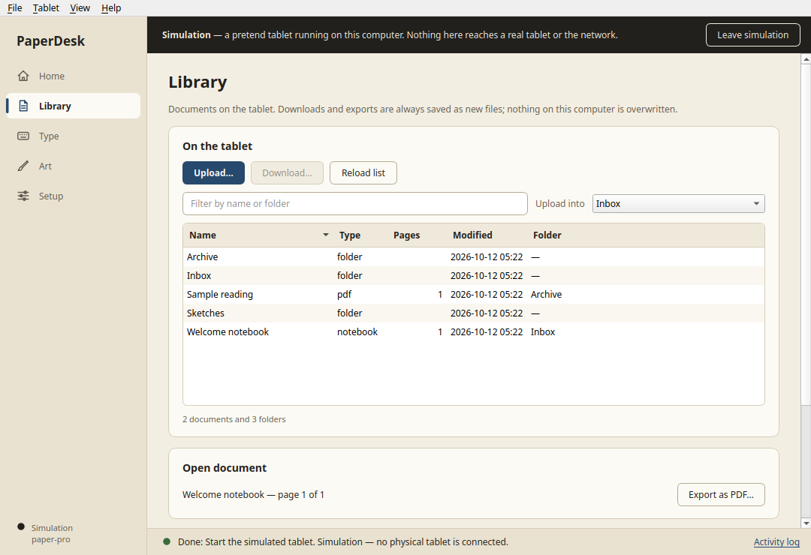

# PaperDesk

A native Qt Widgets desktop companion that brings reMarkable Type, file transfers,
developer-mode setup and desktop art tools into one workspace. No Electron or browser
runtime. Independent community software; not affiliated with reMarkable.

**[Download the desktop preview](https://github.com/gjabdelnoor/paperdesk/releases)**
for Linux, Windows, Apple Silicon or Intel Mac. Start with **Try the simulator**
to explore the whole workspace without a tablet. The normal launcher starts
disconnected.



## One workspace

- **Library:** upload PDF, EPUB and RMDOC files into an existing tablet folder;
  download originals, export annotated PDFs, run an explicit local copy pass,
  and inspect an existing Linux archive-sync timer's status.
- **Type:** keyboard capture and clickable keys, text/image clipboard paste,
  screenshots, native page templates, sticker notebooks, remote touch and
  experimental figure-to-ink conversion with a preview and pen calibration.
- **Art:** open Krita, Inkscape or Blender; choose installed or portable programs;
  use the tablet as a pen input device and mirror Krita's canvas with its palette,
  reference images and canvas gestures.
- **Setup:** guided connection and host-key review, compatibility plan,
  transactional helper installation, diagnostics, reboot recovery and uninstall.
- **Sandbox:** disposable Paper Pro, reMarkable 2 and reMarkable 1 profiles,
  reboot and failure injection using synthetic documents.

The UI was designed and implemented by authenticated Claude Opus in a tmux
contract, then integrated and reviewed against the working backend. It uses
native Qt Widgets and operating-system file dialogs. See the
[UI report](docs/claude-ui-report.md).

## Install and try it

| Computer | Download | Start |
| --- | --- | --- |
| Linux x86-64 | `PaperDesk-linux-x86_64.zip` | Extract and run `PaperDesk/PaperDesk`; `PaperDesk/install.sh` adds a per-user application launcher |
| Windows x86-64 | `PaperDesk-windows-x86_64-setup.exe` | Run the per-user installer; the ZIP is also portable |
| Mac Apple Silicon | `PaperDesk-macos-arm64.dmg` | Drag PaperDesk to Applications |
| Mac Intel | `PaperDesk-macos-x86_64.dmg` | Drag PaperDesk to Applications |

No Python installation is needed for these bundles. On Mac, the preview has an
ad-hoc signature, without Apple Developer ID signing or notarization. macOS may
ask you to approve opening it in **System Settings → Privacy & Security**.
Windows builds also lack a publisher signing certificate. Verify the release's
SHA256 sums before approving a downloaded app.

Open **Try the simulator**, then **Setup → Features** to provision its extras.
**Setup → Sandbox** changes the simulated model and exercises reboot or failed
installation. Simulation creates a private temporary directory; it never opens
SSH or reads your tablet/cloud data.

## Connect a tablet

1. Begin with a tablet already configured for SSH. Paper Pro requires developer
   mode; enabling it performs a factory reset, so follow the
   [manufacturer's instructions](https://developer.remarkable.com/documentation/developer-mode)
   and back up first. reMarkable 1 and 2 do not use this developer-mode switch.
2. Attach USB-C, enable the tablet's **USB web interface**, and open **Setup**.
   Use `10.11.99.1`, user `root`, and the password shown under the tablet's
   **Help → About → Copyrights and licenses**.
3. Review the observed SSH fingerprint, connect, and inspect the helper plan.
   Select the extras you want and install explicitly. Advanced setup restarts
   the tablet interface; save and close your current document first.

PaperDesk never enables developer mode or resets a tablet. File transfers use
xochitl's native importer/exporter. Installation leaves documents alone, retains
previous helper versions and refuses foreign loaders or modified owned files.
After a tablet reboot, restoring advanced loading is an explicit Setup action.
Passwords are held only in memory. See [installer details](docs/installer.md).

Choose ordinary password/key SSH over USB or a reachable network address, or
explicit **Tailscale SSH** using an installed, signed-in Tailscale CLI. PaperDesk
does not install Tailscale, start the tablet's VPN, change cloud configuration or
automatically switch transports. Tailscale policy must permit SSH, SFTP and port
forwarding. The USB and Tailscale SSH servers may have different fingerprints;
never switch transport to repeat an operation whose completion is unknown.
Art mode needs platform input permissions and the Krita plugin when displaying
its canvas; see [art setup](docs/art.md).

The local **copy pass** imports supported files into the tablet's top level and
exports complete PDFs into `device-copies/<timestamp>`. Your existing archive
timer's annotation-only maintenance continues separately; PaperDesk can read
its status without starting or changing it.

## Compatibility and evidence

This is a **prerelease**, with physical tablet validation still pending. Advanced
native images, pages, screen capture, art streams and figure ink require **Paper
Pro, firmware 3.28.0.172 and the exact xochitl digest** in the installer. Other
firmware is refused for those features. reMarkable 1/2 have basic file operations
and architecture-correct keyboard setup, pending physical keyboard testing.
Paper Pro Move and unknown models are not provisioned.

Native builds are tested on Ubuntu 22.04 x86-64, a GitHub-hosted Windows x86-64
VM, macOS 14 Apple Silicon and macOS 15 Intel. Other host versions remain
unverified. The settled Linux preview measured about **131 MiB RAM** and
**0.05% of one CPU core** over a 20-second offscreen sample; active art streaming
and exports have different costs.

The simulator models installation, protocol behavior, persistence and recovery.
It does not emulate proprietary firmware, e-ink, kernel input or physical latency.
Windows pressure and tilt have a separate native receiver test; macOS pen mode
remains experimental. Review the [validation report](docs/validation.md),
[simulator limits](docs/simulator.md) and [native test method](docs/platform-test-method.md).

## Run from source

Python 3.11 or newer:

```sh
python -m venv .venv
# Linux/macOS:
.venv/bin/python -m pip install -e '.[dev]'
.venv/bin/python -m paperdesk --demo
# Windows PowerShell:
.venv\Scripts\python.exe -m pip install -e '.[dev]'
.venv\Scripts\python.exe -m paperdesk --demo
```

Install the optional `.[art]` dependency for Linux pen input when running from source.

## Development

```sh
QT_QPA_PLATFORM=offscreen python -m pytest
python -m paperdesk --smoke-test --screenshot evidence/gui.png
python packaging/build.py
```

Native bundles are built separately on Linux, Windows and macOS by
[GitHub Actions](.github/workflows/native.yml). Source is AGPL-3.0-or-later;
dependency licenses, tablet extension source and build commands are included.
The proprietary reMarkable SDK and firmware are external prerequisites for
rebuilding tablet extensions; they are not distributed.
